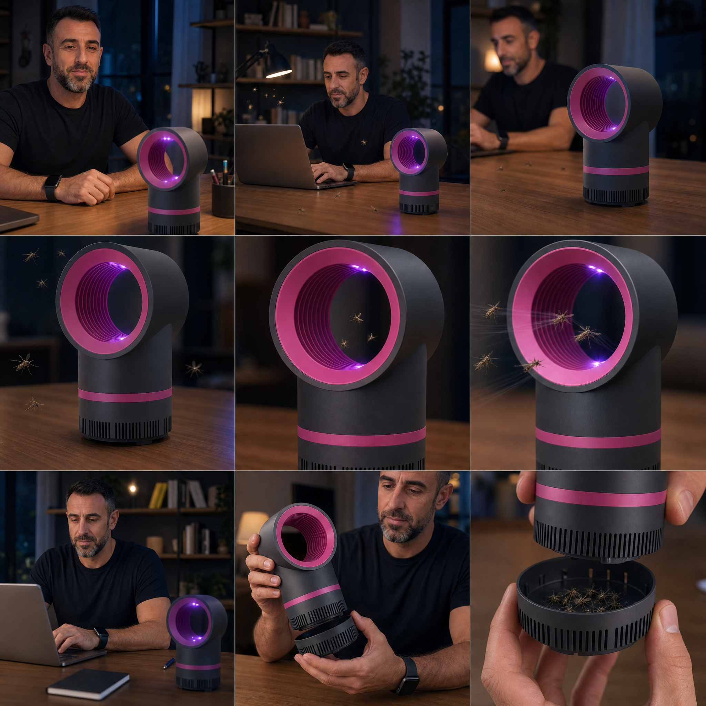

# GUIYI WORKS | Ecommerce Video Creation Toolkit

> This repository presents an ecommerce video creation workflow, case study and service inquiries. Core workflows, templates and code are not public; a complete open-source capability package is not included.

[中文](README.md)

Turn experience into reusable capabilities.

Turn reference videos and product information into product storyboards and plans for motion, camera movement, transitions and audio. Stages 01 and 02 establish the analysis and adaptation basis; 03 and 04 shape the creative execution; 05 checks generated results and identifies where problems need attention.

## Six capabilities

| Stage | Description |
|---|---|
| 00 | Extract video evidence |
| 01 | Analyze the creative |
| 02 | Analyze transferable hooks |
| 03 | Create product storyboards — Includes the original 03 attachment and its handoff |
| 04 | Design motion and shots |
| 05 | Generate and check videos |

## From product inputs to storyboards

The selected case contains four existing assets: a reference video, one product image and two storyboard sheets. The storyboards are historical intermediate results accepted with observations. The case demonstrates storyboard development, not an accepted final film or measured sales performance. Existing case assets are for demonstration and learning; contact the author about commercial reuse.

The product image illustrates an input. Promotional claims printed on it are not presented as verified product efficacy.

[Reference video](source_viral_video.mp4) · [Case stage and observations](CASE_NOTES.md)

## Setup and usage inquiries

Ask about guided use, environment-specific setup and troubleshooting for a product-video task. You may use your own provider accounts or inquire about optional parsing, image-generation and video-generation services. Configuration, availability, scope and fees are confirmed for the actual request.

Beginners can ask about preparing inputs and using each stage. Experienced users can ask about continuing from valid existing work and addressing specific issues. Service fees and external provider usage fees are confirmed separately.

**Email to discuss service fees:** [adxuanyan43@gmail.com](mailto:adxuanyan43@gmail.com)

## Use by paying customers

Paying customers may receive agreed workflow files for use in their own Codex environment and use the workflow to create commercial content for themselves or their clients. Workflow files may not be resold, publicly released or given to others outside the agreed customer. The exact files, usage and support scope are agreed separately. This does not grant commercial rights to the four existing case assets.

## Current scope

This is a showcase and inquiry page. Core workflows, templates and code remain private; no source or installer download is offered. Mac is the main target, but support requires confirmation. Turnkey Agent delivery, unattended operation and automatic updates are not promised. The existing workflow ends at 05-4; later editing and publication are separate.

Version management and updates across multiple Agents remain development goals; no automatic synchronization tool is included here.

[Material-use notice](NOTICE.md)
