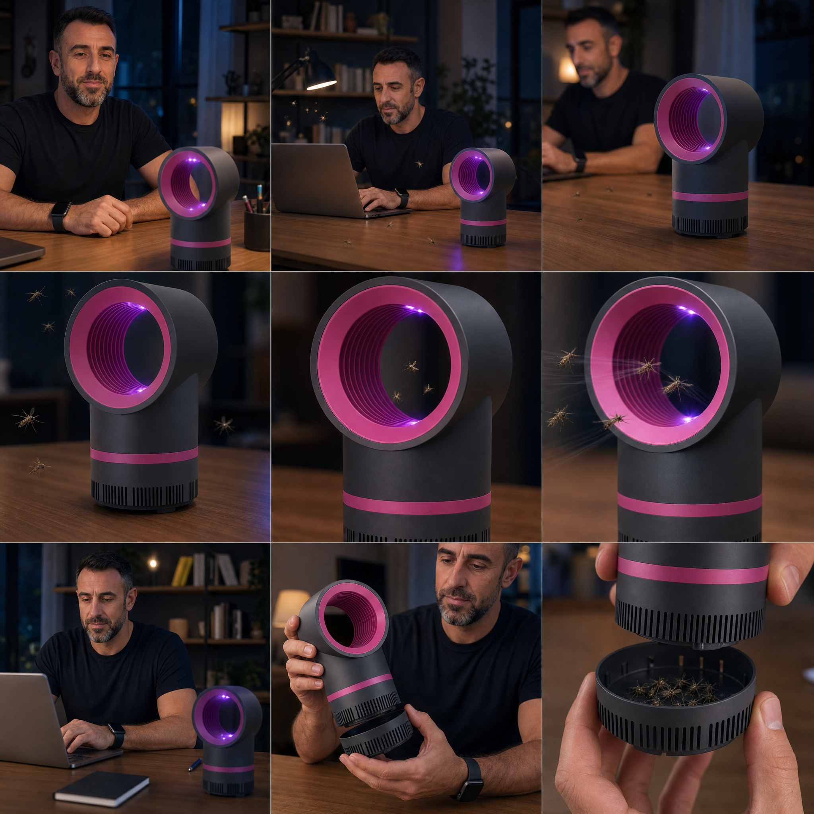

# 皈一造物｜电商视频创作工具箱

**[▶ 打开项目首页：左边原片、右边成品，同步看 30 秒](https://ullhelp58.github.io/guiyi-ecommerce-video-toolkit/)**

给电商商家和内容团队：拿参考视频和商品图，拆创意、做分镜，再为自己的商品生成和检查视频。

> 本仓库用于展示电商视频创作方法、案例与服务咨询。核心流程、模板和代码未公开，本仓库不提供完整开源能力包。

[English](README.en.md) · GUIYI WORKS

把经验做成可复用的能力。

把参考视频与商品资料，转成商品分镜和视频动态设计。01/02提供分析与迁移依据，03/04组织商品呈现、动作、镜头和声音，05检查生成结果并定位问题。

## 六项能力

| 阶段 | 内容 |
|---|---|
| 00 | 提｜视频资料 |
| 01 | 拆｜视频创意 |
| 02 | 移｜爆点迁移分析 |
| 03 | 制｜视频分镜 — 含03附件，实际交接顺序保留 |
| 04 | 创｜视频动态设计 |
| 05 | 生｜视频生成与检查 |

## 从商品资料到分镜

案例包含参考原片、A/B 合并西语字幕成品、商品图及两组分镜。上下游资料用于展示创作过程，商业使用请联系作者。

商品图用于展示输入材料，其宣传文字不作为本项目已核实的产品功效。

[查看参考视频](source_viral_video.mp4) · [案例阶段与观察项](CASE_NOTES.md)

## 使用与服务咨询

可咨询单商品视频任务的使用指导、实际环境配置与问题定位支持。可自备供应商账号，也可咨询可选的解析、生图、视频生成服务；实际配置、承接范围和费用按需求确认。

- 初次使用者：咨询材料准备、工具配置和阶段使用指导。
- 已有经验者：咨询已有成果的承接、具体卡点与使用支持。
- 服务费用与外部平台用量费用分别确认。

**邮件咨询服务费用：** [adxuanyan43@gmail.com](mailto:adxuanyan43@gmail.com)

## 付费客户如何使用

付费客户可按约定取得使用所需的流程文件，在自己的Codex中使用，并为自己或客户制作商业内容。流程文件不得向约定客户之外转售、公开发布或转赠；具体交付文件、使用与支持范围以双方约定为准。这不包含现成案例素材的商业使用授权。

## 当前范围

本页用于展示和咨询，核心流程、模板与代码暂不公开，不提供源码或安装包下载。Mac为主要使用目标，具体支持需核对；不承诺一键交付Agent、无人值守运行或自动同步。原业务止于05-4，后续剪辑与发布另行安排。

多个Agent的版本管理与更新仍是后续建设目标，当前页面不提供自动同步工具。

[材料使用范围说明](NOTICE.md)
